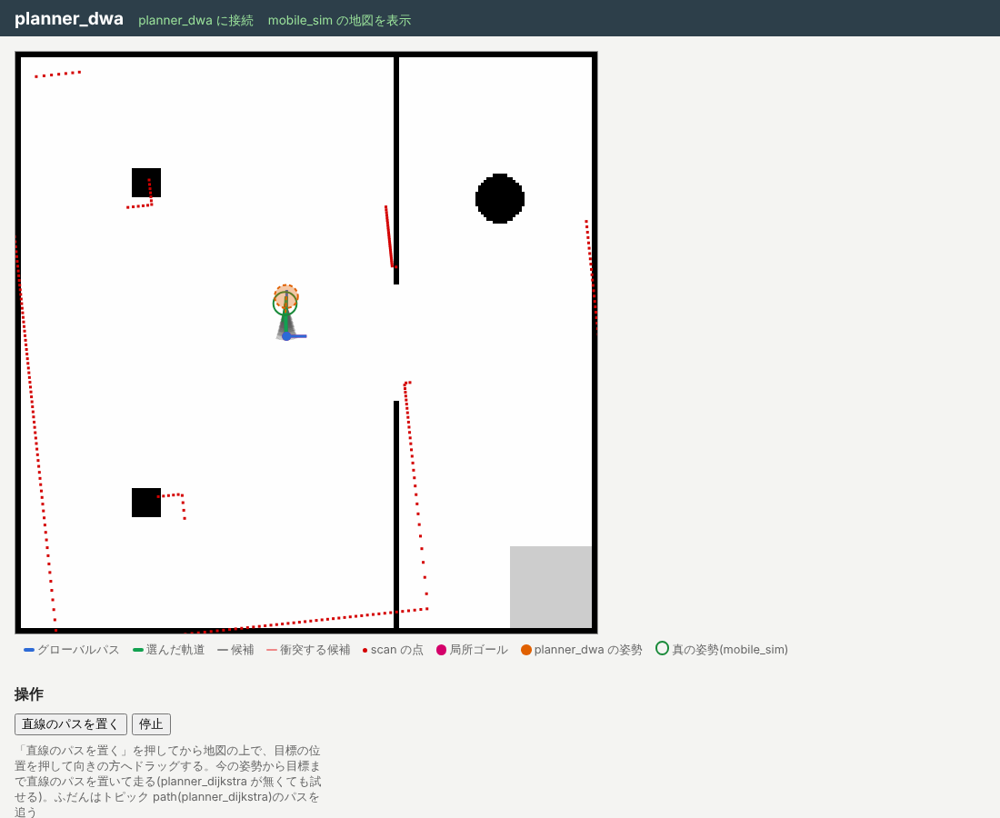

# planner_dwa

地図の上のグローバルパスとロボットの自己位置を受け取り、DWA(Dynamic Window Approach)で
[mobile_sim](https://github.com/OpenJUIZ/mobile_sim) のロボットの速度指令を求める [juiz](https://github.com/OpenJUIZ/juiz) のアプリ(juizapp、ローカルプランナー)です。
ROS の [dwa_local_planner](https://github.com/ros-planning/navigation/tree/noetic-devel/dwa_local_planner) を手本にしていて、パラメータの名前と意味は ROS と同じです。



- グローバルパス: トピック `path`([planner_dijkstra](https://github.com/OpenJUIZ/planner_dijkstra) の経路 `{ok, poses: [Pose2D], ...}`、map)
- 自己位置: トピック `amcl_pose`(`juiz_std.geometry.Pose2DStamped`、[localization_amcl](https://github.com/OpenJUIZ/localization_amcl) が出す)と mobile_sim の `odom`。
  AMCL が更新する間は odom で補います(ROS の map→odom と同じ考え)
- 障害物: mobile_sim の `scan` と `lidar_mount`
- 出力: トピック `cmd_vel`(Twist2D、10 Hz)。mobile_sim は 0.5 s 指令が途切れると止まるので、planner_dwa が落ちてもロボットは止まります
- 状態: トピック `dwa_status`(`{status, has_path, arrived, goal_distance, cmd, local_goal, count}`)。
  `status` は `idle`・`following`・`rotating`・`arrived`・`no_trajectory`・`stuck`・`waiting_for_pose` など

設計とマイルストーンは [docs/plan.md](docs/plan.md)。

## 動かす

juiz 0.2.4 以降と mobile_sim 0.3 系が要ります。

```sh
pip install juiz-cli==0.2.4
juiz run mobile_sim-0.3.3.juizapp        # 先に mobile_sim を動かしておく(http://localhost:8000/)
juiz run planner_dwa-0.1.0.juizapp       # 別の端末で
```

http://localhost:8004/ を開き、「直線のパスを置く」を押してから地図の上で目標を押して向きの方へドラッグすると、
今の姿勢からそこまでの直線のパスを置いて走ります(planner_dijkstra が無くても試せます)。
画面では候補の軌道(灰色、ぶつかるものは赤)、選んだ軌道(緑)、scan の点、局所ゴールが見え、主な重みと速度をスライダーで変えられます。

### 自己位置・グローバルパスとつなぐ

既定の app.conf は `pose_source: amcl` で、localization_amcl の `amcl_pose` が来るまでは止まっています(状態 `waiting_for_pose`)。
AMCL 無しで試すときは app.conf の `pose_source` を `odom` にします(mobile_sim の odom は真の初期姿勢から始まります)。

juiz 0.2.4 では、どのアプリも mobile_sim だけを subsystem にする形だと localization_amcl と planner_dijkstra のトピックが届きません
([juiz#449](https://github.com/OpenJUIZ/juiz/issues/449))。その回避として、app.conf の `bridge` で
localization_amcl(http://localhost:8002)と planner_dijkstra(http://localhost:8003)の `amcl_get_pose`・`planner_get_path` を HTTP で読みます。
4 つ(mobile_sim・localization_amcl・planner_dijkstra・planner_dwa)を動かし、planner_dijkstra の画面で目標を置けば、ロボットがそこまで走ります。

navigation_manager の下で動かすときは bridge を `null` にし、トピックの名前を navigation_manager が出し直す名前(`nav/odom` など)に、
cmd_vel を `cmd_vel_dwa` にします。どれも app.conf の `subscribes`・`publishes` で変えられます。くわしくは [docs/plan.md](docs/plan.md#navigation_manager-の下で動かす)。

### Docker

```sh
docker compose -f docker/compose.yml up
```

mobile_sim(http://localhost:8000/)と planner_dwa(http://localhost:8004/)が一緒に動きます。AMCL が無いので odom を自己位置にしています。
イメージの環境変数:

| 変数 | 既定 | 意味 |
| --- | --- | --- |
| `MOBILE_SIM_URL` | `http://mobile_sim:8000` | つなぐ mobile_sim |
| `DWA_POSE_SOURCE` | `amcl` | `amcl` か `odom` |
| `DWA_BRIDGE_AMCL_URL` | `http://localization_amcl:8002` | bridge で読む localization_amcl(空にすると読まない) |
| `DWA_BRIDGE_PLANNER_URL` | `http://planner_dijkstra:8003` | bridge で読む planner_dijkstra(空にすると読まない) |

### 開発

```sh
cargo test --workspace
scripts/dev_plugin.sh                         # app/plugins/<target>/ にプラグインを置く
(cd ../mobile_sim && scripts/dev_plugin.sh && cd app && juiz -f app.conf -d --ipc mobile_sim)
cd app && juiz -f app.conf -d                 # 別の端末で
python3 scripts/integration_test.py --mobile-sim ../mobile_sim --ui ui_test.png   # 結合テストと画面のテスト
scripts/pack.sh                               # dist/ に .juizapp を作る
```

## juiz の ContainerProcess

コンテナ `dwa_planner`(app.conf では `dwa0`):

| 名前 | 引数 | 戻り値 |
| --- | --- | --- |
| `dwa_set_path` | `path`(planner_dijkstra の経路) | なし(トピック `path` を受ける。`ok: false` や空の経路で止まる) |
| `dwa_set_goal` | `goal: Pose2DStamped` | なし(今の姿勢から直線のパスを置く) |
| `dwa_set_pose` | `pose: Pose2DStamped` | なし(トピック `amcl_pose`) |
| `dwa_set_odometry` | `odom: Pose2DStamped` | なし(トピック `odom`) |
| `dwa_set_scan` | `scan: LaserScan` | なし(トピック `scan`) |
| `dwa_set_laser_pose` | `pose: PoseStamped` | なし(トピック `lidar_mount`) |
| `dwa_compute` | なし | Twist2D(main_loop_ec が 10 Hz で呼び、`cmd_vel` に出す) |
| `dwa_cancel` | なし | なし(パスを捨てて止まる) |
| `dwa_set_params` | `params`(`{名前: 値}`) | 全部のパラメータ |
| `dwa_get_status` | なし | 短い状態(`dwa_status` に出す) |
| `dwa_get_state` | なし | 画面用の状態(姿勢、パス、障害物、候補の軌道など) |

コンテナの引数:

- `params`: ROS dwa_local_planner の名前のパラメータ(`max_vel_x`、`min_vel_theta`、`acc_lim_x`、`acc_lim_theta`、`sim_time`、`vx_samples`、`vth_samples`、
  `path_distance_bias`、`goal_distance_bias`、`occdist_scale`、`forward_point_distance`、`xy_goal_tolerance`、`yaw_goal_tolerance` など。書かないものは ROS の既定値)と、
  `robot_radius`、`inflation_radius`、`cost_scaling_factor`、`local_window`
- `pose_source`(`amcl` か `odom`)、`frame_id`(既定 `map`)、`sensor_timeout`(odom・scan がこれより古ければ止まる、既定 1 s)、
  `require_scan`(既定 true)、`stuck_time`(既定 5 s、0 で使わない)、`bridge`(上の juiz#449 の回避)

app.conf の値は mobile_sim の既定のロボット(半径 0.2 m、加速度 1.0 m/s²・3.0 rad/s²)に合わせてあります。
ROS の既定の `min_vel_theta: 0.4` だと、止まった状態から加速度の制限(3.0 × 0.1 s = 0.3 rad/s)のためにその場で回れないので 0.2 にしています。

## わかっている制約

- 障害物は最新の scan だけを見ます(地図を重ねた局所コストマップは無い)
- planner_dijkstra の初版はロボットの大きさを考えないので、部屋の出入口の角をかすめる経路が出ることがあります。
  planner_dwa はぶつかる軌道を選ばないので、そこで止まってその場で回り、5 s 後に状態を `stuck` にします

## ライセンス

MIT OR Apache-2.0
